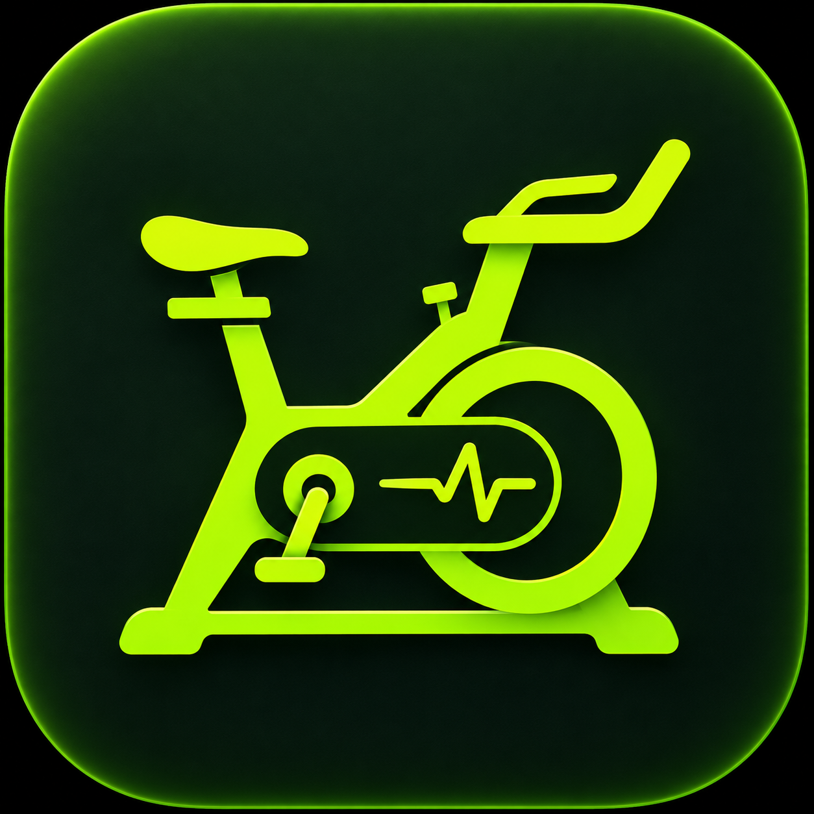
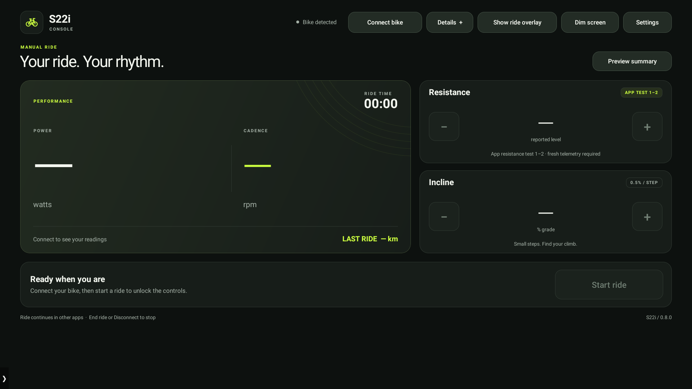
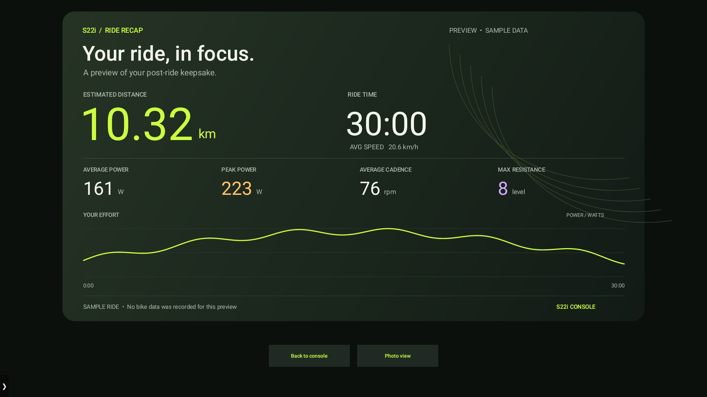

<p align="center">
  
</p>

<h1 align="center">S22i Console</h1>

<p align="center"><strong>Your ride. Your rhythm.</strong><br>An offline Android dashboard for compatible NordicTrack S22i bikes.</p>

<p align="center">
  <strong>Android 9+</strong> · <strong>Native Java</strong> · <strong>Offline</strong> · <strong>Apache-2.0</strong>
</p>

<p align="center">
  <a href="#download">Download</a> · <a href="#features">Features</a> · <a href="#build">Build</a> · <a href="#install-and-use">Install</a> · <a href="CONTRIBUTING.md">Contribute</a> · <a href="AGENTS.md">Developer guide</a>
</p>



<p align="center"><sub>Version 0.8.0 · Clean dashboard, disconnected · No personal ride data</sub></p>

## Download

| Build | Download | Intended use |
| --- | --- | --- |
| **Production — recommended** | [Download APK](https://github.com/isrish/s22i-console/releases/latest/download/s22i-console-release.apk) | Normal riding; Android debugging and diagnostic recording disabled |
| Debug | [Download APK](https://github.com/isrish/s22i-console/releases/latest/download/s22i-console-debug.apk) | Development; Android debugging enabled, private diagnostics opt-in |

[Release notes](https://github.com/isrish/s22i-console/releases/latest) · [SHA-256 checksums](https://github.com/isrish/s22i-console/releases/latest/download/SHA256SUMS.txt)

Both APKs use the same app package and signing identity: installing one replaces the other while retaining app data. Debug builds allow an authorized ADB connection to access the app's private files. Use production for everyday riding. Compatibility and resistance-control limits below apply to both builds.

## Features

| During your ride | While watching | After your ride |
| --- | --- | --- |
| Power, cadence, speed and reported resistance | Full-width floating statistics panel | Distance, time, averages and peaks |
| Ride timer and estimated distance | Whole-ride graphs above another app | A photo-friendly ride summary |
| Explicit Start and End ride | Swipe to reveal; tap an arrow to fold | Optional date/time and private storage |

Tap-to-wake dim mode keeps the console comfortable between rides. Auto-dim defaults to 30 minutes and can be changed in Settings.

### A ride worth remembering



<p align="center"><sub>Actual app preview using synthetic sample data. No real ride or personal timestamp is shown.</sub></p>

The app has no Internet permission, analytics, accounts or cloud upload. Summary dates are hidden by default, and nothing is posted or shared automatically.

## Compatibility and control limits

The current implementation targets Android 9 or later, a landscape console and the FitPro USB controller identified by vendor/product `213c:0002`, equipment type `8`. Compatibility with every S22i revision is not established.

The bike uses magnetic resistance. `Gear` in internal protocol names refers to field 26, not a mechanical drivetrain. The app displays the reported resistance level, but **on-screen resistance adjustments remain limited to levels 1 and 2**. Wider readback support is not evidence that wider app writes are safe or correct. The interface retains its test-limit label. Physical handlebar controls operate through the controller.

Connection alone does not start a workout. Manual adjustments require fresh validated state, and actuator writes are never automatically retried. Read [protocol constraints](docs/PROTOCOL.md) before changing controller code.

## Build

Native Java, no Gradle and no downloaded app libraries. Package: `dev.s22i.console`.

<details>
<summary><strong>Toolchain, signing and build commands</strong></summary>

Install Python 3.9+, JDK 17 and Android SDK command-line tools. Set `JAVA_HOME` to your JDK and `ANDROID_HOME` to your SDK; Java tools can also be found on `PATH`. Install the pinned SDK components:

```sh
sdkmanager "platforms;android-34" "build-tools;34.0.0" "platform-tools"
python3 scripts/test_protocol.py
```

Production builds require a private signing key and its credentials. Use a secret manager or local environment for `S22I_STORE_PASSWORD` and, if different, `S22I_KEY_PASSWORD`. Never commit them.

```sh
export S22I_KEYSTORE="$HOME/.s22i/signing.keystore"
export S22I_KEY_ALIAS="s22i"
python3 scripts/build.py
```

For a **first installation only**, supply those credentials and run `python3 scripts/build.py --init-signing-key` to create a new key. Existing installations must keep their original key and alias to receive updates. Key initialization refuses to replace an existing file.

The default output is `build/s22i-console-release.apk`, signed, alignment-checked and non-debuggable. `python3 scripts/build.py --debug` builds a separate development APK with a local debug identity when no signing overrides are set. Neither command installs anything.

</details>

## Install and use

Enable USB debugging on your own console and authorize your computer. Select the intended device explicitly using `adb devices -l`, then set `S22I_SERIAL` locally to that device's serial or network endpoint.

From the folder containing the downloaded production APK:

```sh
adb -s "$S22I_SERIAL" install -r s22i-console-release.apk
adb -s "$S22I_SERIAL" shell am start -W -n dev.s22i.console/.MainActivity
```

For a local source build, use `build/s22i-console-release.apk` instead. Updates require a matching signing identity; an independently signed build cannot replace the published APK directly.

Tap **Connect bike** and grant USB access if prompted. Start a ride explicitly. Enable Android's display-over-other-apps permission to use the floating panel. The panel can be expanded with an edge swipe and folded with its end arrow. **End ride** remains available while riding in another app.

**Settings** offers auto-dim, summary date/time visibility and saved-ride deletion. Deleting rides requires confirmation and an idle controller with no pending recovery. It does not remove screenshots or separately copied files.

## Privacy and development

<details>
<summary><strong>Privacy guarantees and contributor checks</strong></summary>

Production builds disable diagnostic recording and Android `run-as` access. Debug builds offer explicitly opt-in private diagnostics while disconnected; identity/authentication payloads are redacted. Do not publish diagnostic recordings or real ride data. Android backups are disabled. This does not replace device-level Android or ADB security.

Only source, resources, synthetic tests, build tools, documentation and specifically reviewed README images belong in this repository. Local device inventories, experiment histories, captures, signing keys, APKs and third-party app downloads are excluded. Run the publication check after staging changes:

```sh
python3 scripts/check_publication.py
```

See [AGENTS.md](AGENTS.md) for architecture, verification commands and maintenance constraints.

</details>

## Contributing

Code, documentation, accessibility improvements and ideas are welcome. Start with the [contribution guide](CONTRIBUTING.md) for setup, testing and the pull request workflow.

[Request a feature](https://github.com/isrish/s22i-console/issues/new?template=feature_request.yml) · [Report a bug](https://github.com/isrish/s22i-console/issues/new?template=bug_report.yml) · [Browse open issues](https://github.com/isrish/s22i-console/issues)

You can contribute without bike hardware. Keep examples synthetic and describe clearly what has and has not been tested on a real controller.

## Attribution and license

Licensed under Apache-2.0; see [LICENSE](LICENSE). The protocol implementation adapts work from [STRIDE](https://github.com/keranm/strideApp) and [Hyperborea](https://github.com/ball2jh/Hyperborea). Original license texts, notices, pinned revisions and adaptation details are retained in [app/assets/licenses](app/assets/licenses/README.txt). No iFit applications, firmware or third-party media APKs are distributed here. NordicTrack and iFit are trademarks of their respective owners; this project is independent.

<details>
<summary>About these images</summary>

The dashboard and summary are screenshots of version 0.8.0 running in a separate documentation installation with empty storage. The summary uses the app's built-in sample preview. No controller connection or real ride was used for these images.

The README icon was generated with built-in imagegen to match the app's charcoal-and-lime palette. The [generation prompt](docs/assets/icon-prompt.txt) is included. The installed Android launcher icon is unchanged.

</details>
